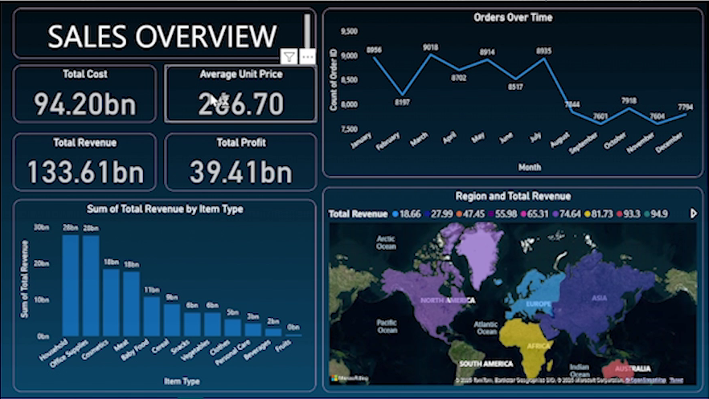
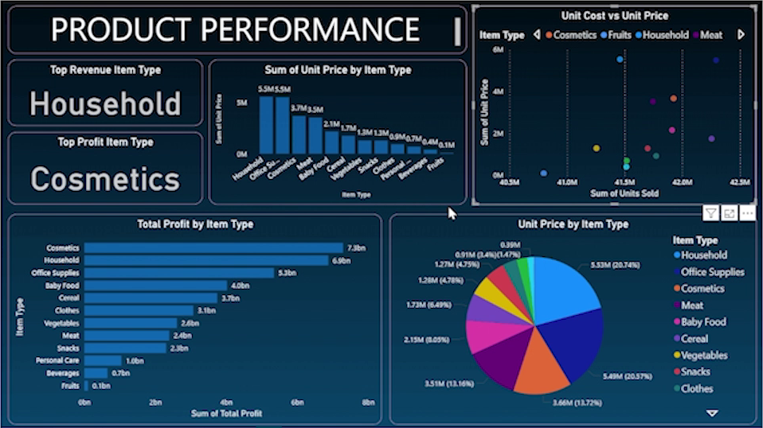
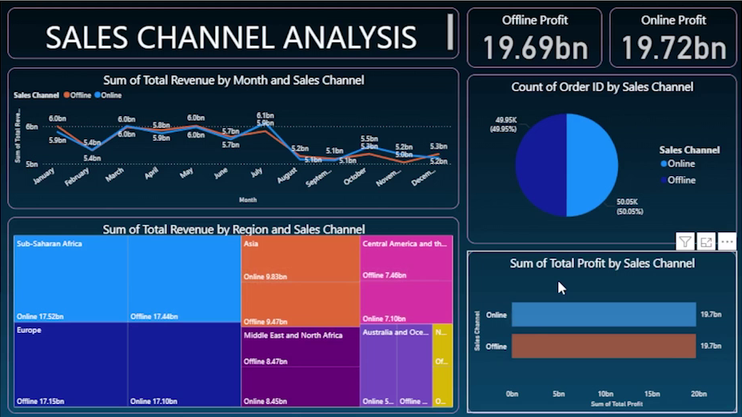
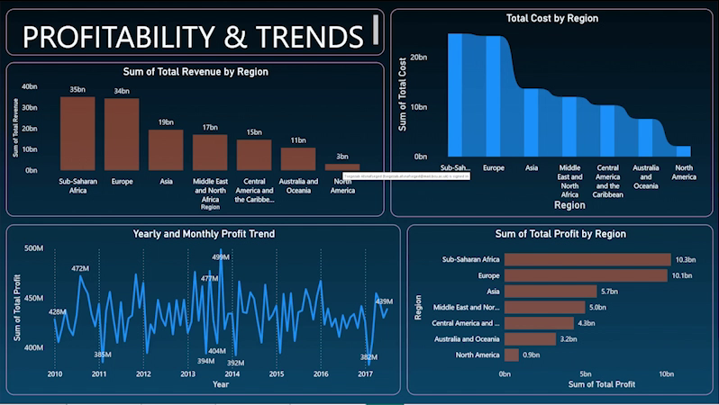
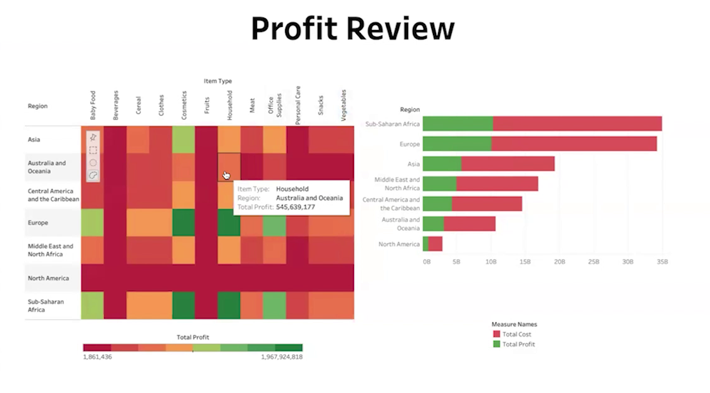
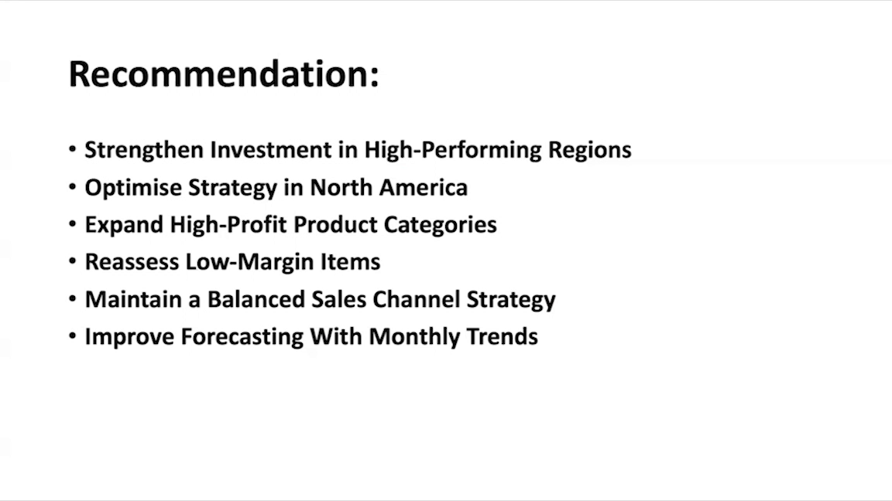

# Global Sales Performance Dashboard (Power BI)

An interactive **Power BI** dashboard built on 100,000 global sales orders (2010–2017). It turns raw transactions into insight on revenue, cost, profit, products, regions and sales channels, and ends with business recommendations.

**Team project.** CMP7227 Data Visualisation, MRes Computing, Birmingham City University (2025/26)

| Team member | Contribution |
|---|---|
| Sahil | Sales Overview page |
| Saud | Product Performance page |
| Rudra | Sales Channel Analysis page |
| Zack | Profitability & Trends page |
| **Sadia Tasnim Barsha** | **Final summary: conclusions and business recommendations drawn from all four pages** |

---

## Dashboard

### 1. Sales Overview


### 2. Product Performance


### 3. Sales Channel Analysis


### 4. Profitability & Trends


### Supporting view: Profit Review (Tableau)


## Headline figures

| KPI | Value |
|---|---|
| Total revenue | **133.61 bn** |
| Total cost | **94.20 bn** |
| Total profit | **39.41 bn** (29.5% margin) |
| Average unit price | **266.70** |
| Online vs offline profit | 19.72 bn vs 19.69 bn |

These figures were independently recomputed from the raw data with [`analysis/verify_kpis.py`](analysis/verify_kpis.py) and match the dashboard exactly ([output](analysis/verify_kpis_output.txt)).

## Conclusions and recommendations *(my contribution)*

**Conclusions**
- Europe, Sub-Saharan Africa and Asia perform strongest.
- North America shows the lowest profitability.
- Focusing on high-profit regions gives better returns.
- Strong product categories should be expanded.
- A balanced online and offline strategy should be kept.
- Overall aim: higher profit and better efficiency.

**Recommendations**
1. Strengthen investment in high-performing regions.
2. Optimise strategy in North America.
3. Expand high-profit product categories.
4. Reassess low-margin items.
5. Maintain a balanced sales-channel strategy.
6. Improve forecasting with monthly trends.



### Further analysis: margin vs volume

Re-checking the raw data adds an important nuance to these recommendations:

- **Profit margin is almost identical in every region (29.4–29.7%).** North America's low total profit (0.87 bn) comes from **low order volume** (2,133 orders, about 2% of the total), not weak margins. The North America recommendation is therefore a *market-growth* problem, not a pricing problem.
- **Margins differ a lot between products.** Clothes earn a 67% margin and cereal 43%, while meat earns 14% and office supplies 19%. This supports *"reassess low-margin items"*. High-revenue lines such as office supplies and household goods make thin margins.
- **Sales channels are balanced.** Online and offline are almost exactly 50/50 in both orders and profit, which supports keeping both.

## Tools

Power BI (DAX measures, KPI cards, maps, treemaps, slicers) · Tableau (heat map) · Python/pandas (verification)

## Data

[`data/100000_Sales_Records.csv.zip`](data/): a public sample sales dataset (via Kaggle) of 100,000 orders with region, country, item type, sales channel, priority, order and ship dates, units, unit price, unit cost, revenue, cost and profit.

```bash
pip install pandas
python analysis/verify_kpis.py
```

## Repository contents

```
.
├── README.md
├── images/                        # dashboard screenshots
├── data/100000_Sales_Records.csv.zip
├── analysis/verify_kpis.py        # recomputes headline KPIs from raw data
├── analysis/verify_kpis_output.txt
└── slides/conclusion_and_recommendations.pptx
```
